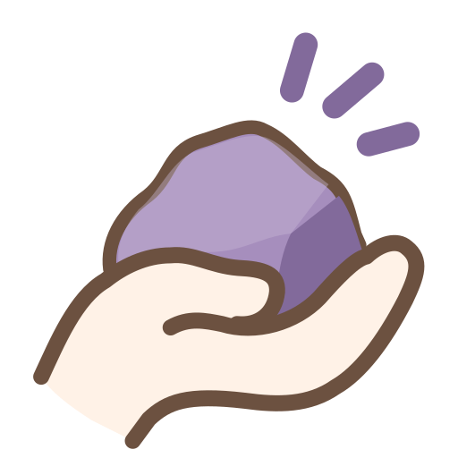

# I Have a Rock

*A plugin connecting Zotero and Obsidian.*

[English](README.md) · [繁體中文](README.zh-tw.md)

## Why the name?

Zotero gets its name from the Albanian word *zotëroj*, which means "to own" or "to master."

Obsidian, on the other hand, is a type of volcanic glass. Basically, a rock.

So I guess I have a rock.

## Requirements

Zotero 10, with the Local API turned on in Zotero's settings.

## Privacy

| | |
|---|---|
| Network use | Connects only to Zotero on this computer (`127.0.0.1:23119`, the Zotero Local API). Nothing is sent to the internet. |
| Files outside the vault | Reads Zotero's data folder: `storage/` to show PDFs, and `cache/library/` for annotation images. Read only. |

## License

[MIT](LICENSE) © David Chang